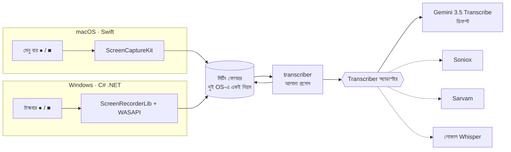
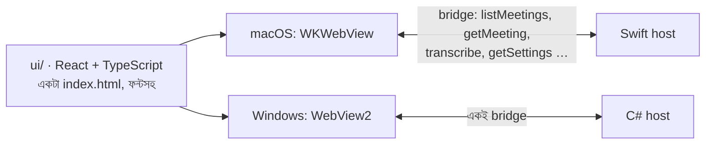
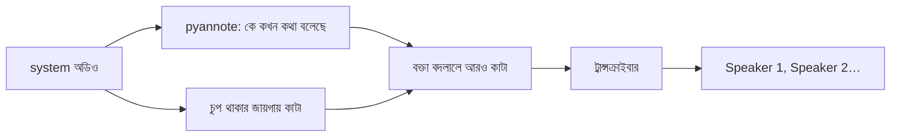
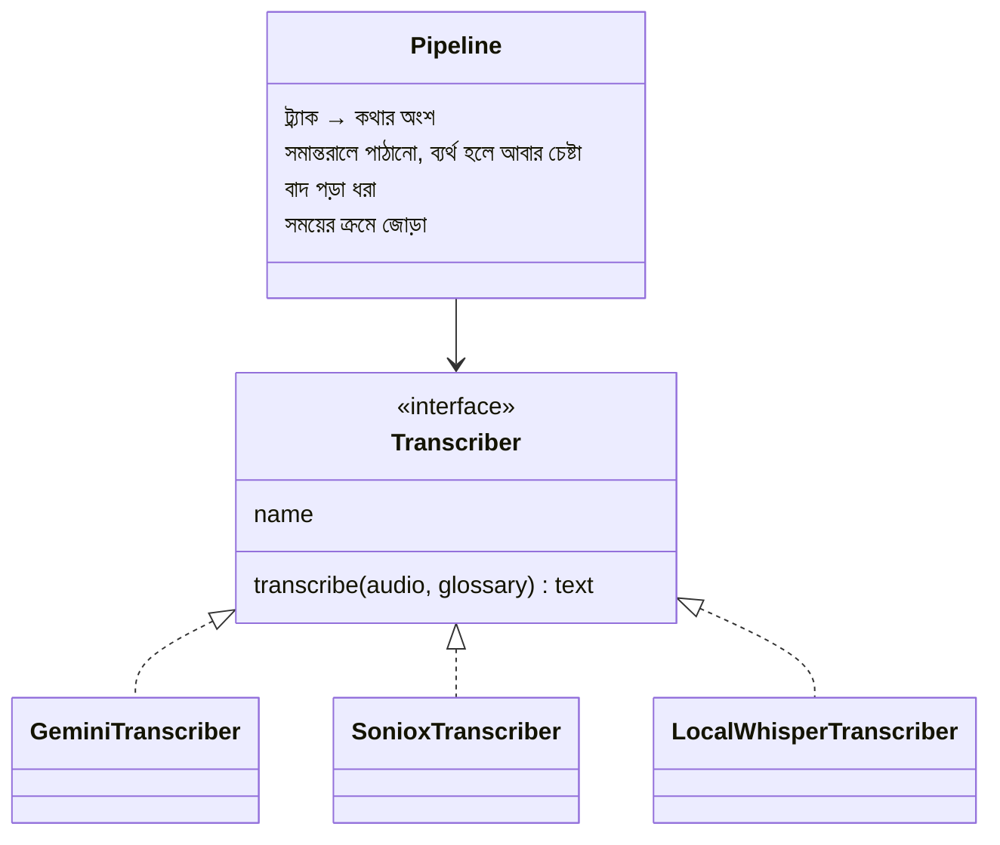
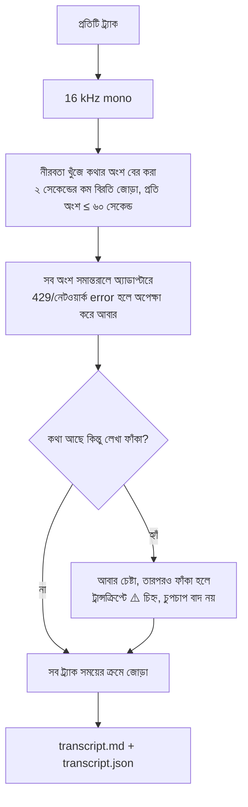

# বাংলা মিটিং রেকর্ডার: ডিজাইন

এক ক্লিকে মিটিং রেকর্ড হবে: সব ডিসপ্লে আর সব অডিও ডিভাইস। রেকর্ড শেষে বাংলা, ইংরেজি আর মেশানো কথার ট্রান্সক্রিপ্ট তৈরি হবে। ট্রান্সক্রিপশনের সার্ভিস যেকোনো সময় বদলানো যাবে।

## পুরো সিস্টেম



ট্রে অ্যাপ আর transcriber দুটো আলাদা প্রোগ্রাম। এর সুবিধা তিনটা:

- ট্রান্সক্রিপশন ব্যর্থ হলেও রেকর্ডিং নিরাপদ থাকে।
- পুরোনো রেকর্ডিং আবার নতুন মডেলে চালানো যায়।
- Voice Memos বা অন্য যেকোনো অডিও ফাইলও একই কমান্ডে চলে।

## Mac আর Windows দুই প্ল্যাটফর্মে

স্ক্রিন আর অডিও রেকর্ড করার কোড প্রতিটি OS-এ আলাদা লিখতেই হবে। Mac-এ ScreenCaptureKit, Windows-এ Graphics Capture আর WASAPI loopback। কোনো cross-platform ফ্রেমওয়ার্ক এই অংশটা নিজে থেকে দেয় না। ট্রে আইকনের কোড খুবই ছোট। তাই প্রতিটি OS-এ নেটিভ ট্রে অ্যাপ বানানো হবে, আর দুটোর মধ্যে যা ভাগ হবে:

| ভাগ করা অংশ | কীভাবে |
|---|---|
| transcriber | একই Python প্রোগ্রাম। দুই অ্যাপই রেকর্ড শেষে `transcribe <folder>` চালায় |
| মিটিং ফোল্ডারের নিয়ম | একই ফাইলের নাম (নিচে)। এটাই দুই অ্যাপের মধ্যে চুক্তি |
| ব্যবহার | বাম ক্লিকে রেকর্ড শুরু বা বন্ধ, ডান ক্লিকে মেনু, শেষে নোটিফিকেশন |
| **UI** | Meetings আর Settings উইন্ডো একই React অ্যাপ ([ui/](ui/))। Mac-এ WKWebView, Windows-এ WebView2 |

## UI: React, দুই OS-এ একই



- UI-র ভাষা **ইংরেজি**। ট্রান্সক্রিপ্ট যেমন বলা হয়েছে তেমন থাকে, অর্থাৎ বাংলা।
- ফন্ট Inter (ইংরেজি) আর Hind Siliguri (বাংলা), দুটোই অ্যাপের ভেতরে রাখা, তাই ইন্টারনেট লাগে না। রং: কালি #16181D, ইন্ডিগো #4338CA, রেকর্ড লাল #E5484D।
- UI আর নেটিভ অ্যাপের চুক্তি লেখা আছে [ui/src/types.ts](ui/src/types.ts)-এ। Windows host-কে শুধু এই method-গুলো বানাতে হবে।
- ব্রাউজারে `npm run dev` চালালে নমুনা ডেটা দিয়ে UI চলে, কোনো host লাগে না। ডিজাইনের কাজ এভাবেই সবচেয়ে দ্রুত হয়।
- API key UI-তে কখনো ফেরত আসে না। UI শুধু জানে key আছে কিনা।

বিকল্প ছিল Tauri: একটা UI কোড, কিন্তু রেকর্ডিংয়ের অংশ তবুও প্রতিটি OS-এর জন্য নেটিভ plugin হিসেবে লিখতে হতো। শুধু একটা ট্রে আইকন ভাগ করার জন্য Rust আর Node-এর বাড়তি টুল বহন করা লাভজনক নয়।

## মিটিং ফোল্ডার

```
~/Meetings/2026-10-26_1430/
├── display-1.mp4      প্রতিটি ডিসপ্লে আলাদা ভিডিও
├── display-2.mp4
├── mic.m4a            আমার মাইক → বক্তা "Me"
├── system.m4a         Zoom/Teams-এর আওয়াজ → বক্তা "Others"
├── transcript.md      পড়ার জন্য
└── transcript.json    প্রোগ্রামের জন্য (সময়, বক্তা, লেখা)
```

## কেন আলাদা ট্র্যাক, কেন diarization নয়

নিজের একটা বাংলা-ইংরেজি মেশানো রেকর্ডিং দিয়ে ২০২৬-১০-২৬ তারিখে পরীক্ষা করা হয়েছে:

| সেটিং | ফলাফল |
|---|---|
| শুধু অডিও | "এপিআই", "ডেপ্লয়", "সার্ভার": ইংরেজি শব্দগুলোও বাংলা হরফে |
| **শব্দকোষ (custom vocabulary)** | "API", "deploy", "server": ইংরেজি শব্দ ইংরেজি হরফে, আর শব্দকোষে দেওয়া নামগুলোও সঠিক |
| diarization (বক্তা আলাদা করা) | আবার বাংলা হরফে। শব্দকোষের সাথে একসাথে চালানো যায় না |

তাই আমরা শব্দকোষ রাখছি। বক্তা আলাদা হবে ট্র্যাক দেখে: মাইকের ট্র্যাক মানে "Me", সিস্টেম অডিওর ট্র্যাক মানে "Others"।

### ২০২৬-১০-২৮: "Others"-এর ভেতরে বক্তা আলাদা করা, নিজের কম্পিউটারে

Gemini-র diarization শব্দকোষের সাথে চলে না, তাই বক্তা আলাদা করার কাজটা ট্রান্সক্রিপশন থেকে আলাদা রাখা হয়েছে। [pyannote community-1](https://huggingface.co/pyannote/speaker-diarization-community-1) মডেলটা নিজের কম্পিউটারে চলে, শুধু গলা শোনে, তাই যেকোনো ট্রান্সক্রাইবারের সাথে কাজ করে (`transcriber/speakers.py`)।



- **মিটিংয়ের পরে মোড:** আগে বক্তা আলাদা করা হয়, তারপর প্রতিটা টুকরো একজন বক্তার। কোনো অডিও দুবার ট্রান্সক্রাইব হয় না।
- **লাইভ মোড:** মিটিং চলার সময় "Others" থাকে, কারণ গলা আলাদা করতে পুরো রেকর্ডিং লাগে। Stop-এর পরে একবার আলাদা করা হয়। যে টুকরোয় একজন, তার শুধু নাম বদলায়। যে টুকরোয় কয়েকজন, শুধু সেটা কেটে আবার ট্রান্সক্রাইব হয়।
- **নাম:** মিটিং পেজে ক্লিক করে নাম বদলানো যায় (`--rename-speaker`)। দুজনকে একই নাম দিলে এক হয়ে যায়।
- **ব্যর্থ হলে:** মডেল না থাকলে বা ভুল হলে "Others" রেখে ট্রান্সক্রিপ্ট লেখা হয়, কখনো হারায় না।
- **গোপনীয়তা:** pyannote-এর ব্যবহারের তথ্য পাঠানো (telemetry) বন্ধ। মডেল একবার নামানোর পর ইন্টারনেট লাগে না।

M3-এ মাপা খরচ, এক ঘণ্টার মিটিংয়ে: GPU-তে ~৬ মিনিট (প্রসেসরের ~২ মিনিট, ০.৮ GB), শুধু প্রসেসরে ~৪০ মিনিট (~৩.৫টা কোর, ৩.৮ GB)। তাই ডিফল্ট GPU। Windows-এ শুধু NVIDIA কার্ড, CUDA-র PyTorch (২.৬ GB) একবার নামিয়ে; `uv`-র `cpu`/`cuda` extra-র conflict দিয়ে lock-এ দুই রকম PyTorch রাখা হয়েছে।

## অ্যাডাপ্টার প্যাটার্ন



অ্যাডাপ্টারের কাজ শুধু একটা: **একটা ছোট অডিও টুকরো থেকে লেখা।** টুকরো করা, আবার চেষ্টা করা, বাদ পড়া ধরা আর জোড়া লাগানো, সব pipeline-এর দায়িত্ব। তাই নতুন সার্ভিস যোগ করতে হলে শুধু একটা ছোট ক্লাস লিখে registry-তে নাম দিলেই হয়। সার্ভিস বদলাতে কোড ছুঁতে হয় না, শুধু সেটিং বদলালেই চলে:

```bash
TRANSCRIBER=gemini-3.5-transcribe   # ডিফল্ট
```

## Pipeline



কথার অংশ ছোট রাখার তিনটা কারণ:

- দুই ট্র্যাকের কথা সঠিক ক্রমে সাজানো যায়।
- লম্বা অডিওতে LLM মডেলের অংশ বাদ দেওয়া বা একই কথা বারবার লেখার ঝুঁকি কমে।
- কোনো অংশ ব্যর্থ হলে শুধু সেটুকু আবার পাঠাতে হয়।

২ ঘণ্টার মিটিং মানে কয়েকশো ছোট অনুরোধ। এতে খরচ বাড়ে না, কারণ বিল হয় অডিওর টোকেন ধরে। শুধু ফ্রি key-র মিনিটপ্রতি সীমা আটকে দিতে পারে, তাই নিয়মিত ব্যবহারে billing চালু রাখতে হবে।

## চালানো

```bash
cd transcriber && uv sync --python 3.12      # প্রথমবার; key থাকবে transcriber/.env-এ
uv run transcribe ~/Desktop/recording.m4a   # একটা ফাইল → পাশে .transcript.md
uv run transcribe ~/Meetings/2026-10-26_1430     # ফোল্ডার: mic.* = Me, system.* = Others
```

শব্দকোষ কোডে থাকে না, প্রতিটি ব্যবহারকারীর নিজের সেটিংস ফোল্ডারে থাকে: `glossary.txt`, পাশে API key-র জন্য `.env`। Mac-এ `~/Library/Application Support/AnyMeet`, Windows-এ `%APPDATA%\AnyMeet`। অ্যাপের Settings → Glossary থেকে, অথবা ফাইলটা নিজে খুলে শব্দ যোগ করা যায়। মানুষের নাম আর প্রজেক্টের নাম এখানে যোগ করলে লেখা সবচেয়ে বেশি উন্নত হয়। কোনো অংশ লেখা না গেলে ট্রান্সক্রিপ্টে ⚠️ চিহ্ন থাকে আর কমান্ড exit code 1 দেয়।

**ফ্রি key দিয়ে মিটিং চলবে না।** ফ্রি key-তে এই মডেলে দিনে মাত্র ২৫টা অনুরোধ পাঠানো যায় (২০২৬-১০-২৬-এ 429 error থেকে যাচাই করা), অথচ ২ ঘণ্টার মিটিংয়ে লাগে ১৫০–২৫০টা।

## খরচ (Gemini 3.5 Transcribe)

ঘণ্টায় প্রায় $০.৩৫, মানে দিনে ২ ঘণ্টা মিটিং হলে মাসে প্রায় $১৫। হিসাব একটা ১ মিনিটের পরীক্ষার আসল টোকেন থেকে। পেইড স্তরে অডিও Google-এর ট্রেনিংয়ে যায় না।

## ধাপ

| ধাপ | কাজ | অবস্থা |
|---|---|---|
| P0 | সার্ভিসগুলোর তুলনা ([benchmark/](benchmark/README.md)) | চালু; Gemini 3.5 Transcribe বাছাই |
| P1 | transcriber: অ্যাডাপ্টার, pipeline, CLI ([transcriber/](transcriber/)) | এই ধাপ |
| P2 | macOS মেনু বার অ্যাপ ([recorder-macos/](recorder-macos/)): প্রতিটি ডিসপ্লে, সিস্টেম অডিও, মাইক; React UI ([ui/](ui/)): Meetings আর Settings উইন্ডো | চালু; ৮ সেকেন্ডের আসল রেকর্ডিং আর UI আসল ডেটা দিয়ে যাচাই করা |
| P3 | Windows টাস্কবার অ্যাপ ([recorder-windows/](recorder-windows/README.md), C# .NET 8): ScreenRecorderLib + NAudio WASAPI, একই ফোল্ডারের নিয়ম, একই React UI WebView2-তে | macOS-এ compile আর GitHub Actions-এ Windows build হয়; Windows কম্পিউটারে চালানো বাকি |
| P4 | Claude দিয়ে সারাংশ, মিটিং খোঁজা, নিজের সংশোধন সংরক্ষণ (ভবিষ্যতের ট্রেনিং ডেটা) | পরে |
