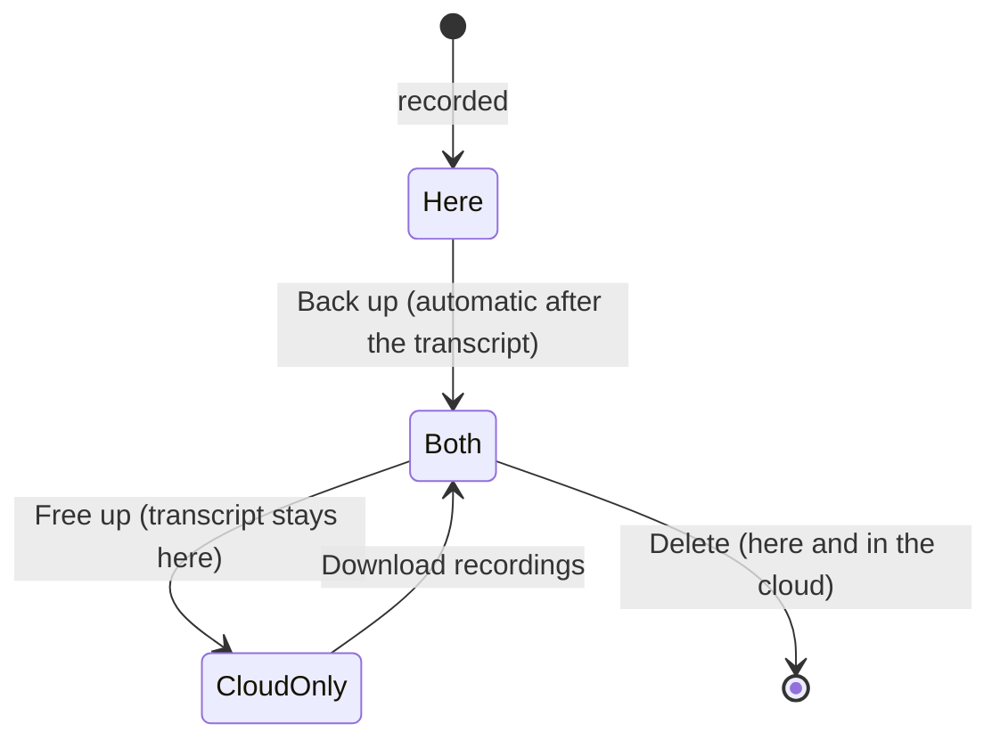

# AnyMeet

AnyMeet is a bot-free meeting recorder for macOS and Windows. One click records every display, your microphone and the system audio (Zoom, Teams, Meet …) as separate files. The transcript grows while you talk, or is written when you stop, and handles **Bangla, English and mixed Bangla-English speech**.

- **No meeting bot.** Everything is captured on your own computer; recordings stay in `~/Meetings`.
- **Who said what.** Your microphone is "Me". Everyone else, in the system audio, can be told apart by voice as Speaker 1, Speaker 2… on your own computer, and renamed on the meeting page.
- **Your words, spelled right.** A personal glossary (names, products, jargon) keeps English terms in English letters.
- **Swappable transcription.** Gemini 3.5 Transcribe by default, or free Whisper models that run on your own computer (one for Bangla, one for English). Providers plug in through a small adapter.
- **Play it back in the app.** Click a time in the transcript to hear that moment from the speaker's own track; recordings play inside the app with the system's own decoders.
- **Cloud backup, free disk.** Each meeting can be backed up to your own S3 bucket; then its recordings can leave this computer and be downloaded again when you need them, while the transcript stays.
- **AI summary.** Claude writes what was decided, who does what, and the topics in order, from the transcript.

| Folder | What's inside |
|---|---|
| [recorder-macos/](recorder-macos/) | macOS menu-bar app (Swift, ScreenCaptureKit). Build with `./build.sh` |
| [recorder-windows/](recorder-windows/README.md) | Windows tray app (C# .NET 8, ScreenRecorderLib, NAudio, WebView2) |
| [ui/](ui/) | Meetings and Settings windows (React), shared by both apps. `npm run dev` runs it with sample data |
| [transcriber/](transcriber/) | Audio → transcript, with one adapter per provider |
| [benchmark/](benchmark/README.md) | Compare speech-to-text providers on your own audio |
| [model/](model/README.md) | Plan for an open Bangla-English speech model, and how to contribute |
| [assets/icon/](assets/icon/) | App icon: SVG masters, `make-icons.sh` builds the macOS `.icns` and Windows `.ico` |
| [DESIGN.md](DESIGN.md) | Architecture and decisions (in Bangla) |

## Install on macOS

Every `v*` tag builds a macOS DMG and a Windows zip with GitHub Actions and publishes them under [Releases](https://github.com/mirsabbir/anymeet/releases). The app is not signed with an Apple Developer ID yet, so macOS has to be told to trust it (the `xattr` line).

```bash
cd ~/Downloads && curl -LO https://github.com/mirsabbir/anymeet/releases/latest/download/AnyMeet-macOS.dmg
hdiutil attach AnyMeet-macOS.dmg
cp -R "/Volumes/AnyMeet/AnyMeet.app" /Applications/
hdiutil detach "/Volumes/AnyMeet"
xattr -dr com.apple.quarantine "/Applications/AnyMeet.app"
defaults write com.mirsabbir.anymeet transcriberProject <repo-path>/transcriber
open "/Applications/AnyMeet.app"
```

Transcription needs a clone of this repository (the `transcriberProject` path above) plus `uv` and `ffmpeg` (`brew install uv ffmpeg`). On the first recording macOS asks for Screen Recording and Microphone access. Because the app is ad-hoc signed, it asks again after each update.

Windows: see [recorder-windows/README.md](recorder-windows/README.md).

## Updates

From v0.3.2 on, AnyMeet checks GitHub Releases when it opens and every six hours. When a new version is out, the Meetings window shows **Update & restart**: it downloads the release, replaces the app and reopens it. Settings → About & updates shows your version and has **Check now**. Updating is blocked while a recording or a transcription is running.

## "The app won't open"

AnyMeet is not signed with a paid Apple Developer ID or a Windows code-signing certificate yet, so both systems warn about it the first time. The app is safe to open; the source is all here.

**macOS: "AnyMeet is damaged and can't be opened" or "Apple could not verify AnyMeet"**

Remove the download quarantine flag, then open it again:

```bash
xattr -dr com.apple.quarantine /Applications/AnyMeet.app
```

Or without Terminal: try to open the app once, then go to **System Settings → Privacy & Security**, scroll down to the message about AnyMeet and click **Open Anyway**.

**macOS: it asks for Screen Recording / Microphone again after an update**

Expected for now: an unsigned app looks like a new app to macOS after every update. Allow it again, then quit and reopen AnyMeet. Old entries for AnyMeet in the Screen Recording list can be removed with **−**.

**Windows: "Windows protected your PC" (SmartScreen)**

Click **More info → Run anyway**. If Windows blocks the zip's files, right-click the downloaded zip → **Properties** → tick **Unblock** → OK, then unzip again.

## Transcription

Settings → Transcription picks the model and when it runs.

| Model | Where it runs | Notes |
|---|---|---|
| Gemini 3.5 Transcribe | Google's API | Needs a Gemini API key (prepaid credits); about $0.35 per hour of audio. **A Tier 1 key allows only 100 requests a day on this model**, and a meeting is cut into hundreds of parts, so until the key's tier goes up use Gemini 3.8 Flash |
| Gemini 3.8 Flash | Google's API | The same Gemini key, with a far higher daily limit. A general model told to transcribe; it matched Transcribe in a spot check on a mixed Bangla/English meeting but isn't in [benchmark/](benchmark/README.md) yet |
| Local Whisper (Bangla) | Your computer, offline | Free, 1.5 GB. Bangla only: English words come out in Bangla letters. On an M3, 1 minute of audio takes about 1 minute |
| Local Whisper (English) | Your computer, offline | Free, 1.6 GB (Whisper large-v3-turbo). English-only meetings; Bangla speech comes out translated or garbled |

Local models are downloaded from Hugging Face to `~/.cache/huggingface`. Picking one in Settings that isn't on the computer yet starts the download there, with a progress bar; the app also installs the extra Python packages it needs. From the command line: `uv run transcribe --models` lists what is downloaded, and `uv run --extra local transcribe --download local-whisper-english` fetches one.

No local model handles Bangla and English in the same sentence yet; use Gemini for mixed meetings.

**When to transcribe**

- **Live, while recording** (default): the apps also write `live/mic.wav` and `live/system.wav` as they record. The transcriber cuts them at pauses and sends each piece as soon as it ends, so `transcript.md` grows during the meeting and is finished a few seconds after you stop (longer with the local model if it falls behind).
- **After the meeting**: the whole recording is transcribed when you stop.
- **Off**: transcribe later from the meeting page.

Both modes work with every model. From the command line: `uv run transcribe <meeting-folder>` (add `--live` to follow a recording in progress).

**While it runs, and when parts are missing**

- The top of the meeting page shows what the transcription is doing ("Telling the speakers apart…", "Transcribing part 268 of 723"), a progress bar, and **Stop**. Stop sends nothing more; the parts already sent finish, and the run ends within seconds (at most 30 s).
- Parts that could not be transcribed are marked ⚠️, and a banner says how many and why, in the transcriber's own words: for a used-up daily limit, which model, how many requests a day, and when it resets.
- **Try again** sends only those parts and leaves the rest of the transcript as it is; speakers keep their names. From the command line: `uv run transcribe <meeting-folder> --only-failed`.
- **Transcribe again** starts over. If that run ends with more parts missing than the transcript it would replace (a limit hit, or Stop), the earlier transcript is kept.
- A daily limit stops the run at once instead of retrying every part; a per-minute limit is waited out by all parts together.

**Telling speakers apart**

Settings → Transcription → Speakers. Turned on, the system audio ("Others") is split by voice into Speaker 1, Speaker 2… when the meeting ends, and every part of the transcript gets one speaker. It runs on your computer with [pyannote community-1](https://huggingface.co/pyannote/speaker-diarization-community-1) and works with every model above, since it only listens to voices. Click a name on the meeting page to rename it everywhere; giving two speakers the same name merges them.

- **One-time setup:** the model is free but gated. Sign in at Hugging Face, accept its terms, create a token of type "Read" and paste it into Settings. The model (33 MB) then downloads, and after that it works offline. pyannote's usage telemetry is switched off.
- **Live mode:** the transcript says "Others" during the meeting, because telling voices apart needs the whole recording. After Stop the system audio is split once; a part with one speaker is relabelled, and only parts where several people spoke are transcribed again.
- **If it can't run** (no model, an error), the transcript is still written, with "Others".
- **Command line:** `uv run --extra speakers transcribe <meeting-folder> --speakers`, and `uv run transcribe <meeting-folder> --rename-speaker "Speaker 1" "Rahim"`.

**GPU or processor**

Settings → Transcription → Run local models on: the graphics card or the processor. It applies to the local Whisper models and to telling speakers apart. Measured on a MacBook Air M3 (8 cores, 16 GB) with a 10-minute, four-voice English test clip, per hour of meeting:

| Job | On the GPU | On the processor |
|---|---|---|
| Telling speakers apart | ~6 min, ~2 min of processor time, 0.8 GB | ~40 min with ~3.5 cores busy, 3.8 GB |
| Local Whisper (English) | ~21 min, ~3 min of processor time | slower; not measured |

On the GPU your processor stays mostly free for other work. The test clip's 4 voices were all found, with a diarization error rate of 7.9%; real meetings with similar voices or crosstalk will do worse.

- **macOS:** the Apple GPU (through Metal), the default.
- **Windows:** NVIDIA cards only; the app finds them with `nvidia-smi`. Choosing the GPU installs PyTorch built for CUDA once (2.6 GB, needs a recent NVIDIA driver) and checks that the card works (`transcribe --device`). Other cards, and PCs without one, use the processor, which is also the default.

## Cloud backup

Settings → Cloud & AI. A meeting has two homes: this computer and the cloud, matched by its folder name. Once a meeting's files are in the cloud, the meeting page says **Backed up · safe to remove … from this computer**, and **Free up** deletes its video and audio here while the transcript stays. **Download recordings** brings them back; a meeting that is only in the cloud (deleted here, or recorded on another computer) is listed as **In the cloud**.

- **Server:** an AnyMeet Cloud server: a small AWS stack (a Lambda that hands out presigned S3 URLs, and a private S3 bucket). The app sends its address and access token; it never holds AWS keys.
- **Automatic:** with "Back up automatically" on, each meeting is backed up when its transcript is ready (or when recording stops, if transcription is off). Settings also backs up every meeting not in the cloud yet, and frees space for all backed-up meetings at once.
- **Big files:** files go straight to S3 in 16 MiB parts, 4 at a time. Each part carries its MD5, so S3 refuses damaged bytes, and a file counts as backed up only when S3's checksum of the whole file equals the one computed here. A dropped connection is retried with backoff for up to 10 minutes; parts already sent stay, so a backup cut off by Stop, sleep, a crash or no network goes on where it stopped (also when the app next opens). Downloads fetch 8 ranges at a time and resume the same way.
- **Free up** checks with the server first and deletes only recordings whose cloud copy matches the file here; anything changed since, or not in the cloud, is kept.
- **Delete** on a backed-up meeting deletes it in both places (the cloud keeps old versions for 30 days).
- **In the cloud** (Settings → Cloud & AI) lists every meeting in the cloud with its size and where it is (only in the cloud, or here too), the total and a rough monthly cost. Tick meetings to delete their cloud copies at once; copies on this computer stay, and it warns first when a recording exists only in the cloud.
- **Command line:** `uv run anymeet backup|restore|free|forget <meeting-folder>…`, `uv run anymeet sync ~/Meetings`, `uv run anymeet check`. A job's progress is in `<meeting>/job.json`, what the cloud holds in `<meeting>/cloud.json`.



## AI summary

Settings → Cloud & AI → AI summary. With an Anthropic API key, **Summarize** on a meeting page sends the transcript to Claude Opus 5.5, which returns a title, an overview, decisions, action items with owners, topics with times (click one to play from there) and open questions. It is saved as `summary.json` in the meeting folder (and backed up with it). "Summarize automatically" does it once per meeting when the transcript is ready; summaries can be written in the meeting's own language, English or Bangla. An hour-long meeting costs about $0.20–0.50. From the command line: `uv run anymeet summarize <meeting-folder> [--language auto|en|bn]`.

## Settings

Nothing personal lives in the code. Each user's settings folder holds:

- `.env`: the API key, e.g. `GEMINI_API_KEY=…`, the Hugging Face token for the speaker model, `HF_TOKEN=…`, the cloud server, `ANYMEET_CLOUD_URL=…` and `ANYMEET_CLOUD_TOKEN=…`, and Claude's key, `ANTHROPIC_API_KEY=…`
- `glossary.txt`: one term per line

| OS | Folder |
|---|---|
| macOS | `~/Library/Application Support/AnyMeet/` |
| Windows | `%APPDATA%\AnyMeet\` |
| Linux (CLI only) | `~/.config/anymeet/` |

All can be edited from the app: Settings → Transcription, Glossary, and Cloud & AI.

## Tests

```bash
cd transcriber && uv run pytest                       # transcriber: audio splitting, pipeline, CLI, live mode, speakers, cloud backup, summaries
recorder-macos/build.sh && recorder-macos/build.noindex/AnyMeet.app/Contents/MacOS/AnyMeet --self-test /tmp/anymeet-test.json --fake-capture
```

The macOS self-test drives the real app: it records (with `--fake-capture`, a spoken test clip instead of the screen), stops from the menu-bar item, runs the transcriber after the meeting and live (the transcript must appear while still recording), checks the menu-bar icon at every step, pastes into the API key field and copies to the clipboard, then writes a pass/fail report. Without `--fake-capture`, start it with `open -a AnyMeet --args --self-test <report.json>` so the real screen capture runs under AnyMeet's own permission. It also plays a track from the transcript inside the app, and stops the way the system's ⏹ in the menu bar does (that button stops only the screen video, so AnyMeet has to notice and stop the rest). Last, it checks the GPU/processor choice and the speakers switch in Settings, and renames a speaker on a meeting page by clicking it and typing, which must rewrite the transcript files.

`--speakers-test` records a WAV of several voices as the system audio (`--fake-system`, 16 kHz mono) with "Tell speakers apart" on, transcribes it after the meeting and live, and checks that "Others" comes out as Speaker 1, Speaker 2…. It needs the speaker model downloaded:

```bash
recorder-macos/build.noindex/AnyMeet.app/Contents/MacOS/AnyMeet --self-test /tmp/anymeet-speakers.json --fake-capture --speakers-test --fake-system voices.wav
```

`--download-test <model>` checks a local model download through Settings instead: the card says it isn't downloaded, clicking it shows progress up to the end, and the transcriber finds every file. Give it an empty `HF_HOME` so it really downloads and leaves your model cache alone:

```bash
HF_HOME=$(mktemp -d) recorder-macos/build.noindex/AnyMeet.app/Contents/MacOS/AnyMeet --self-test /tmp/anymeet-download.json --download-test local-whisper-english
```

`tests/test_cloud.py` runs the backup client against an in-process fake of the server and S3: a crash mid-upload resumes without sending parts again, dropped connections and server errors, damaged parts, a long outage, Stop, freeing space, a cut and a killed download, and sync.

GitHub Actions runs the transcriber tests and builds on every push.

## License

[MIT](LICENSE)
