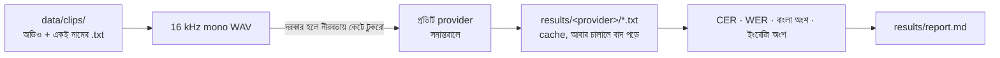

# বাংলা STT তুলনা (P0)

আমাদের নিজের মিটিংয়ের অডিওতে কোন speech-to-text সবচেয়ে নির্ভুল, তা মাপার টুল। রেকর্ডারে কোন সার্ভিস ব্যবহার হবে, এই ফলাফল দেখে সেই সিদ্ধান্ত নেওয়া হবে।



## চালানো

```bash
cp .env.example .env        # যার key আছে শুধু সেটা ভরো
uv sync --python 3.12       # লোকাল মডেলের জন্য: --extra local
uv run python -m bench.run --list
uv run python -m bench.run                                 # key আছে এমন সব cloud provider
uv run python -m bench.run -p local-bengaliai-whisper      # লোকাল মডেল নাম দিয়ে চালাতে হয়
```

পাইপলাইন ঠিক চলছে কিনা দেখতে `uv run python -m bench.fetch_samples -n 5` চালালে Google FLEURS থেকে ৫টা বাংলা ক্লিপ নামবে। এগুলো উইকিপিডিয়া পড়ার রেকর্ডিং, মিটিং নয়। তাই এর ফলাফল দেখে provider বাছা যাবে না।

## নিজের ক্লিপ বানানোর নিয়ম

- `data/clips/meeting01.m4a` আর `data/clips/meeting01.txt`। প্রতিটি ক্লিপ ৫–১০ মিনিটের, মোট ১০টার মতো।
- মিশ্রণ রাখো: শুধু বাংলা, শুধু ইংরেজি, আর বাংলা-ইংরেজি মেশানো (যেমন "deploy টা fail করছে")।
- `.txt`-তে ঠিক যা বলা হয়েছে তা-ই লিখবে। **বাংলা শব্দ বাংলা হরফে, ইংরেজি শব্দ ইংরেজি হরফে।** এই নিয়ম না মানলে "CER English part" কলামের হিসাব ভুল আসবে।
- প্রথম খসড়া যেকোনো একটা provider দিয়ে লিখিয়ে নিয়ে তারপর হাতে ঠিক করা চলে। তবে ঠিক করার সময় প্রতিটি শব্দ অডিও শুনে মেলাতে হবে।
- `data/`, `results/`, `work/` আর `.env` git-এ যায় না।

## মেট্রিক

| কলাম | মানে |
|---|---|
| CER | অক্ষর-ভিত্তিক ভুলের হার, **মূল মাপকাঠি**। বাংলায় শব্দের মাঝে ফাঁক অনিয়মিত, তাই WER অযথা বেশি দেখায়। |
| CER Bangla part / English part | শুধু বাংলা হরফ বা শুধু ইংরেজি হরফের অংশ। কোনো provider ইংরেজি শব্দ বাংলা হরফে লিখলে (deploy → ডিপ্লয়) দুই কলামই খারাপ দেখাবে। মিশ্র কথায় সে কেমন করে, তা এখান থেকে বোঝা যায়। |
| $/hour | প্রতি ঘণ্টা অডিওর list price, অক্টোবর ২০২৬-এর তথ্য। `?` মানে দাম যাচাই করা হয়নি। |

## যে provider-গুলো আছে

| নাম | মডেল | টুকরো |
|---|---|---|
| sarvam-v4 / sarvam-v3-codemix | `saaras:v4`, `saaras:v3` (mode=codemix) | ২৮ সেকেন্ড (sync API) |
| soniox | `stt-async-v5`, ভাষার ইঙ্গিত bn+en | পুরো ফাইল |
| elevenlabs | `scribe_v2` | পুরো ফাইল |
| deepgram | `nova-3`, `bn` | পুরো ফাইল |
| openai-gpt-transcribe | `gpt-transcribe` | ১০ মিনিট |
| gemini-3.5-transcribe / gemini-3.8-flash | একই prompt দিয়ে | ১০ মিনিট (inline সীমা ২০ MB) |
| local-bengaliai-whisper | `bengaliAI/tugstugi_bengaliai-asr_whisper-medium` | ২৮ সেকেন্ড |
| local-whisper-turbo | `openai/whisper-large-v3-turbo` | ২৮ সেকেন্ড |

Cloud provider-গুলোর request format প্রতিটির ডকুমেন্টেশন থেকে নেওয়া (অক্টোবর ২০২৬)। **API key দিয়ে এখনো কোনোটা চালানো হয়নি।** প্রথমবার চালালে কোনো provider ব্যর্থ হলে `results/<provider>/*.error` ফাইলে কারণ লেখা থাকবে।

## পটভূমি: প্রকাশিত বেঞ্চমার্ক (সেপ্টেম্বর ২০২৬)

[riverbornai/bangla-speech-to-text-benchmark](https://github.com/riverbornai/bangla-speech-to-text-benchmark) প্রকাশিত একটা বেঞ্চমার্ক। এতে ১,০০১টা ছোট ক্লিপ (মোট ৫০ মিনিট), ১৩টা ধরনের বিষয়, **কিন্তু কোনো মিশ্র কথা বা আঞ্চলিক উপভাষা নেই।** batch ফলাফল, CER:

| Sarvam saarika:v2.5 | Soniox async v5 | Deepgram nova-3 | Gemini 2.5 Flash | ElevenLabs scribe | Chirp 2 | gpt-4o-transcribe | Whisper large-v3 |
|---|---|---|---|---|---|---|---|
| 6.9% | 8.1% | 10.1% | 13.3% | 14.7% | 21.9% | 28.7% | 30.7% |

এর পর নতুন মডেল এসেছে (`saaras:v4`, `gemini-3.5-transcribe`, `gpt-transcribe`), যেগুলো ওই বেঞ্চমার্কে নেই। মিটিংয়ের মিশ্র বাংলা-ইংরেজি কথা কোনো প্রকাশিত বেঞ্চমার্কেই মাপা হয়নি। এই টুল সেই ফাঁকটাই পূরণ করে।
