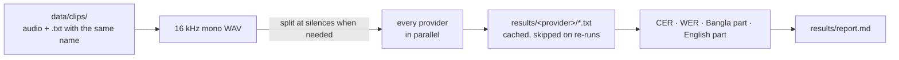

# Bangla speech-to-text benchmark

Measures which speech-to-text provider is most accurate **on your own meeting audio**: Bangla, English and mixed Bangla-English.



## Run

```bash
cp .env.example .env        # fill in only the keys you have
uv sync --python 3.12       # add --extra local for the local models
uv run python -m bench.run --list
uv run python -m bench.run                                 # every cloud provider with a key
uv run python -m bench.run -p local-bengaliai-whisper      # local models are run by name
```

To check the pipeline works, `uv run python -m bench.fetch_samples -n 5` downloads five Bangla clips from Google FLEURS. They are read Wikipedia sentences, not meetings, so don't pick a provider from them.

## Your own clips

- `data/clips/meeting01.m4a` with `data/clips/meeting01.txt`. Aim for about ten clips of 5–10 minutes each.
- Mix it up: only Bangla, only English, and mixed speech (e.g. "deploy টা fail করছে").
- Write exactly what was said in the `.txt`. **Bangla words in Bangla script, English words in English letters.** The "CER English part" column depends on this.
- A first draft from any provider is fine, as long as you correct it word by word against the audio.
- `data/`, `results/`, `work/` and `.env` are not committed.

## Metrics

| Column | Meaning |
|---|---|
| CER | Character error rate, **the main metric**. Bangla word spacing varies, so WER over-penalizes correct letters. |
| CER Bangla part / English part | Only the Bangla-script or only the Latin-script characters. A provider that writes English words in Bangla script (deploy → ডিপ্লয়) scores badly on both: this is how mixed speech shows up. |
| $/hour | List price per hour of audio, October 2026. `?` means the price wasn't checked. |

## Providers

| Name | Model | Chunks |
|---|---|---|
| sarvam-v4 / sarvam-v3-codemix | `saaras:v4`, `saaras:v3` (mode=codemix) | 28 s (sync API) |
| soniox | `stt-async-v5`, language hints bn+en | whole file |
| elevenlabs | `scribe_v2` | whole file |
| deepgram | `nova-3`, `bn` | whole file |
| openai-gpt-transcribe | `gpt-transcribe` | 10 min |
| gemini-3.5-transcribe / gemini-3.8-flash | same prompt | 10 min (20 MB inline limit) |
| local-bengaliai-whisper | `bengaliAI/tugstugi_bengaliai-asr_whisper-medium` | 28 s |
| local-whisper-turbo | `openai/whisper-large-v3-turbo` | 28 s |

Request formats come from each provider's documentation (October 2026). Only `gemini-3.5-transcribe` and `local-bengaliai-whisper` have been run so far. When a provider fails, the reason is in `results/<provider>/*.error`.

## Background: a published benchmark (September 2026)

[riverbornai/bangla-speech-to-text-benchmark](https://github.com/riverbornai/bangla-speech-to-text-benchmark) tested 1,001 short clips (50 minutes, 13 domains), **without code-mixed speech or regional dialects**. Batch results, CER:

| Sarvam saarika:v2.5 | Soniox async v5 | Deepgram nova-3 | Gemini 2.5 Flash | ElevenLabs scribe | Chirp 2 | gpt-4o-transcribe | Whisper large-v3 |
|---|---|---|---|---|---|---|---|
| 6.9% | 8.1% | 10.1% | 13.3% | 14.7% | 21.9% | 28.7% | 30.7% |

Newer models (`saaras:v4`, `gemini-3.5-transcribe`, `gpt-transcribe`) came out afterwards. No published benchmark measures mixed Bangla-English meeting speech; this tool fills that gap for your own audio.
