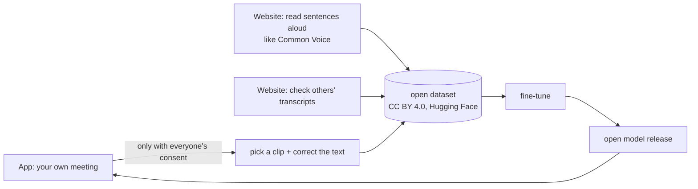

# An open Bangla-English speech model: plan

Goal: an **open-source** speech-to-text model that is strong at **Bangla, English and mixed Bangla-English speech**, and runs on an ordinary Mac. Weak spots in other languages are fine; good models already exist for those.

This is a plan; no model has been trained yet. Dataset sizes and licenses come from sources published in 2026. Check each one again before use.

## Decision 1: fine-tune, don't train from scratch

| | From scratch | Fine-tune an open model |
|---|---|---|
| Data | 10,000+ hours of labelled audio | 1–3 thousand hours of public Bangla + a few hundred hours of mixed speech |
| Compute | weeks on many GPUs | days on a few rented GPUs |
| Risk | high | low: the base model already understands speech |

Models like Whisper were trained on hundreds of thousands of hours of multilingual audio. The job is to make one excellent at Bangla and at the way people in Bangladesh mix Bangla and English.

## Decision 2: model size (it must run on a Mac)

| Base model | Parameters | On a Mac | Notes |
|---|---|---|---|
| **Whisper large-v3-turbo** | ~809M | faster than real time on M1/M2/M3 with MLX or whisper.cpp; ~0.5 GB at 4-bit | **First choice.** Multilingual and already strong in English, a good base for mixed speech |
| Whisper small | ~244M | runs on older Macs and low RAM | lighter variant, less accurate |
| IndicConformer (bn) | ~120M | very fast (CTC/RNN-T) | Bangla only, weak English, limited for mixed speech |

The baseline to beat is BengaliAI's Bangla fine-tune of Whisper-medium, already in the [benchmark](../benchmark/README.md) as `local-bengaliai-whisper`.

## Decision 3: data

| Dataset | Contents | License (verify) | Commercial use |
|---|---|---|---|
| Mozilla Common Voice (bn) | read sentences | CC0 | ✅ |
| OpenSLR-53 | ~229 h Bangla | CC BY-SA 4.0 | ✅ (share-alike) |
| Google FLEURS (bn_in) | ~10+ h, read | CC BY 4.0 | ✅ |
| AI4Bharat IndicVoices / Shrutilipi | Indian Bangla, conversation and radio | CC BY 4.0 | ✅ |
| MUCS 2021 Bengali-English | ~46 h of **mixed speech** (technical lectures) | CC BY-SA 4.0 | ✅ (share-alike) |
| Bengali.AI Speech (Kaggle) | large, varied | check the competition terms | ❓ |
| BanSpeech | 13 domains | CC BY-NC | ❌ evaluation only |

**The big gap:** there is no public dataset of **mixed office or meeting conversation** from Bangladesh ("deploy টা fail করছে কেন"). That data has to be collected, with people's help.

### Labels we must not use

Transcripts from commercial or closed APIs (Gemini, OpenAI …) must not be used as training labels: many terms of service forbid using outputs to build competing models. Use human-corrected text, and open-model output that a person has checked.

## How people can contribute

- **Consent first.** Everyone whose voice is in a clip must agree, not just the person donating it. A "Donate this clip" button must not proceed without it.
- **Start with your own voice.** Donating only the mic track ("Me") needs only your own consent.
- **Privacy.** A step removes names, numbers and addresses.
- **First target:** 100–300 hours of checked mixed speech, part of it held out as a **public test set**, which doesn't exist anywhere yet.

## Plugging it into the app

The app is ready for this through the transcriber's adapter pattern ([DESIGN.md](../DESIGN.md)). Once a model exists:

1. Add a `local-bangla` adapter to `transcriber` that runs on the Mac with MLX or whisper.cpp, no internet needed.
2. Replace the "Not added yet" card in Settings with the model.

## Milestones

| Step | Work |
|---|---|
| M0 | Set the bar on your own meetings in the benchmark: Gemini, Soniox, Sarvam, BengaliAI-Whisper |
| M1 | Fine-tune Whisper-turbo on public data (commercial-friendly licenses only) → v0 |
| M2 | Contribution tools: "Donate" in the app + a read/check website; 100–300 h of mixed speech |
| M3 | v1: fine-tuned on mixed speech, open weights, local adapter for Mac |
| M4 | Hosted API (paid) for people who can't run it themselves |

## Sustainability

The model and the code stay open. Income can come from a hosted API, team subscriptions, and custom glossary or fine-tuning services. That is why **training data must allow commercial use**; NC-licensed data is for evaluation only.
