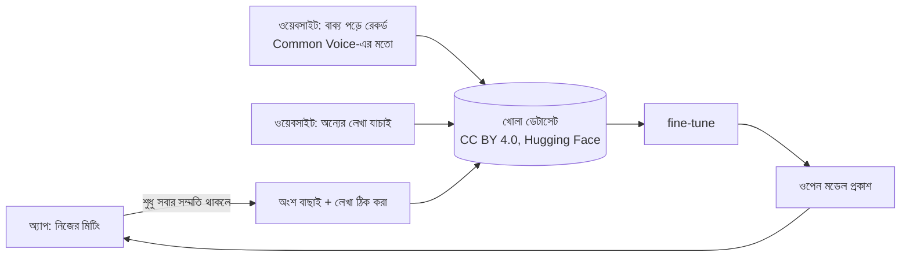

# নিজেদের বাংলা ট্রান্সক্রিপশন মডেল: পরিকল্পনা

লক্ষ্য: একটা **ওপেন সোর্স** speech-to-text মডেল, যা **বাংলা, ইংরেজি আর দুটো মেশানো কথায়** দক্ষ, আর একটা সাধারণ Mac-এ চলে। অন্য ভাষায় দুর্বল হলে সমস্যা নেই, কারণ সেগুলোর জন্য ভালো মডেল আগে থেকেই আছে।

এই পাতা পরিকল্পনা মাত্র, এখনো কোনো মডেল ট্রেন করা হয়নি। ডেটাসেটের ঘণ্টা আর লাইসেন্সের তথ্য ২০২৬ সালের প্রকাশিত উৎস থেকে নেওয়া। ব্যবহারের আগে প্রতিটা আবার যাচাই করতে হবে।

## সিদ্ধান্ত ১: শূন্য থেকে নয়, fine-tune

| | শূন্য থেকে ট্রেন | ওপেন মডেল fine-tune |
|---|---|---|
| ডেটা | ১০,০০০+ ঘণ্টা লেবেল করা অডিও | ১–৩ হাজার ঘণ্টা পাবলিক বাংলা + কয়েকশো ঘণ্টা মেশানো কথা |
| কম্পিউট | কয়েক সপ্তাহ, অনেক GPU | কয়েক দিন, ভাড়া করা কয়েকটা GPU |
| ঝুঁকি | উঁচু | কম: ভিত্তি মডেল আগে থেকেই কথা বোঝে |

Whisper-এর মতো মডেল লাখো ঘণ্টার বহুভাষিক অডিওতে আগেই শিখে আছে। আমাদের কাজ শুধু তাকে বাংলা আর বাংলাদেশের মেশানো কথায় দক্ষ করা।

## সিদ্ধান্ত ২: মডেলের আকার (Mac-এ চলতে হবে)

| ভিত্তি মডেল | প্যারামিটার | Mac-এ | মন্তব্য |
|---|---|---|---|
| **Whisper large-v3-turbo** | ~৮০৯M | M1/M2/M3-এ MLX বা whisper.cpp দিয়ে বাস্তব সময়ের চেয়ে দ্রুত; 4-bit-এ ~০.৫ GB | **প্রথম পছন্দ।** বহুভাষিক, ইংরেজি আগে থেকেই শক্ত, মেশানো কথার জন্য ভালো ভিত্তি |
| Whisper small | ~২৪৪M | পুরোনো Mac বা কম RAM-এও চলে | হালকা সংস্করণ, নির্ভুলতা কম |
| IndicConformer (bn) | ~১২০M | খুব দ্রুত (CTC/RNN-T) | শুধু বাংলা, ইংরেজি দুর্বল। মেশানো কথায় সীমিত |

ভিত্তি হিসেবে তুলনা করবো BengaliAI-এর বাংলায় fine-tune করা Whisper-medium-এর সাথে। আমাদের [benchmark](../benchmark/README.md)-এ এটা `local-bengaliai-whisper` নামে আগে থেকেই আছে।

## সিদ্ধান্ত ৩: ডেটা

| ডেটাসেট | কী আছে | লাইসেন্স (যাচাই করতে হবে) | বাণিজ্যিক ব্যবহার |
|---|---|---|---|
| Mozilla Common Voice (bn) | মানুষের পড়া বাক্য | CC0 | ✅ |
| OpenSLR-53 | ~২২৯ ঘণ্টা বাংলা | CC BY-SA 4.0 | ✅ (share-alike) |
| Google FLEURS (bn_in) | ~১০+ ঘণ্টা, পড়া | CC BY 4.0 | ✅ |
| AI4Bharat IndicVoices / Shrutilipi | ভারতের বাংলা, কথোপকথন আর রেডিও | CC BY 4.0 | ✅ |
| MUCS 2021 বাংলা-ইংরেজি | ~৪৬ ঘণ্টা **মেশানো কথা** (টেকনিক্যাল লেকচার) | CC BY-SA 4.0 | ✅ (share-alike) |
| Bengali.AI Speech (Kaggle) | বড়, বৈচিত্র্যময় | প্রতিযোগিতার শর্ত দেখতে হবে | ❓ |
| BanSpeech | ১৩ ধরনের বিষয় | CC BY-NC | ❌ শুধু মূল্যায়নের জন্য |

**বড় ফাঁক:** বাংলাদেশের অফিস বা মিটিংয়ের **মেশানো কথোপকথন** ("deploy টা fail করছে কেন")-এর কোনো পাবলিক ডেটাসেট নেই। তাই এই ডেটা আমাদের নিজেদেরই জোগাড় করতে হবে, মানুষের সাহায্য নিয়ে।

### যেভাবে লেবেল বানানো যাবে না

বাণিজ্যিক বা ক্লোজড API-র লেখা (Gemini, OpenAI …) সরাসরি ট্রেনিং লেবেল হিসেবে ব্যবহার করা যাবে না। অনেক সার্ভিসের শর্তে প্রতিযোগী মডেল বানাতে তাদের আউটপুট ব্যবহার নিষেধ। এর বদলে মানুষের হাতে ঠিক করা লেখা, আর ওপেন মডেলের লেখা যেটা মানুষ যাচাই করেছে, সেগুলো ব্যবহার করতে হবে।

## মানুষ কীভাবে অবদান রাখবে

- **সম্মতি আগে:** অডিওতে যতজনের কণ্ঠ আছে, সবার স্পষ্ট সম্মতি লাগবে। এক পক্ষের সম্মতি যথেষ্ট নয়। অ্যাপে "Donate this clip" এমনভাবে বানাতে হবে যাতে সম্মতি না দিলে এগোনো না যায়।
- **নিজের কণ্ঠ দিয়ে শুরু:** শুধু মাইকের ট্র্যাক ("Me") দিলে শুধু নিজের সম্মতিই লাগে।
- **গোপনীয়তা:** নাম, নম্বর আর ঠিকানা মুছে ফেলার ধাপ থাকবে।
- **প্রথম লক্ষ্য:** ১০০–৩০০ ঘণ্টা যাচাই করা মেশানো কথা। এর একটা অংশ আলাদা রাখা হবে **পাবলিক টেস্ট সেট** হিসেবে, যা এখনো কোথাও নেই।

## অ্যাপের সাথে যোগ

অ্যাপ আগে থেকেই এর জন্য তৈরি: transcriber-এর [অ্যাডাপ্টার প্যাটার্ন](../DESIGN.md)। মডেল তৈরি হলে দুটো কাজ লাগবে:

1. `transcriber`-এ একটা `local-bangla` অ্যাডাপ্টার, যেটা MLX বা whisper.cpp দিয়ে Mac-এই চলবে, ইন্টারনেট লাগবে না।
2. Settings-এ "Not added yet" কার্ডের জায়গায় মডেলটা।

## ধাপ

| ধাপ | কাজ |
|---|---|
| M0 | নিজের মিটিং দিয়ে benchmark-এ মাপকাঠি ঠিক করা: Gemini, Soniox, Sarvam, BengaliAI-Whisper |
| M1 | পাবলিক ডেটা (শুধু বাণিজ্যিক-অনুমোদিত লাইসেন্স) দিয়ে Whisper-turbo fine-tune → v0 |
| M2 | অবদানের ব্যবস্থা: অ্যাপে "Donate" + পড়া/যাচাইয়ের ওয়েবসাইট; ১০০–৩০০ ঘণ্টা মেশানো কথা |
| M3 | v1: মেশানো কথায় fine-tune, ওপেন weights, Mac-এ লোকাল অ্যাডাপ্টার |
| M4 | হোস্ট করা API (পেইড), যাদের নিজের মেশিনে চালানোর সুযোগ নেই তাদের জন্য |

## আয়ের পথ

মডেল আর কোড খোলা থাকবে। আয় আসবে হোস্ট করা API, দলের জন্য সাবস্ক্রিপশন আর কাস্টম শব্দকোষ বা fine-tune সেবা থেকে। এই কারণে **ট্রেনিং ডেটার লাইসেন্স অবশ্যই বাণিজ্যিক ব্যবহার অনুমোদন করতে হবে।** NC লাইসেন্সের ডেটা শুধু মূল্যায়নে চলবে।
